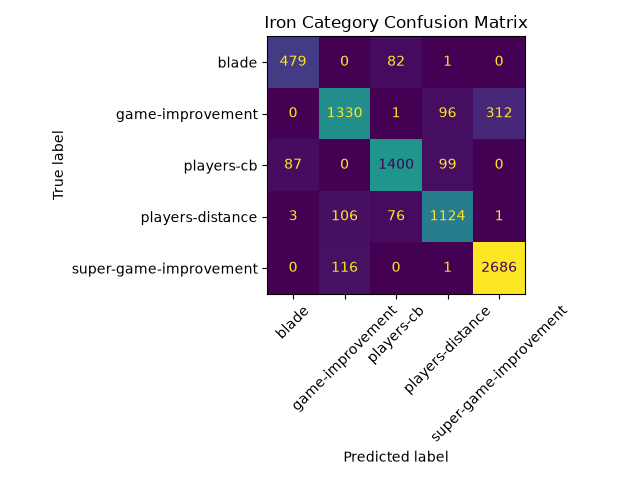

# Stickly (GolfRec)

Stickly recommends golf clubs from a short questionnaire. You enter your handicap, swing speed, and what your ball does, and it predicts the specs a fitter would start from (driver loft, shaft flex, fairway wood loft, iron type, wedge bounce). Then it ranks real drivers, fairway woods, iron sets, and wedges against those specs, with a reason for each pick.

**[Try it at stickly.fit](https://www.stickly.fit/)**

Built with Flask, scikit-learn, pandas, and plain JavaScript. The public site runs this app inside a separate [site wrapper](https://github.com/vincent-bui-se/GolfRec-monetize).


## Running it

Requires Python 3.14 (the saved models were trained on 3.14.4 with the versions in `requirements.lock.txt`).

```bash
python -m venv .venv
source .venv/bin/activate        # Windows: .\.venv\Scripts\Activate.ps1
python -m pip install -r requirements.lock.txt
python app.py
```

Then open [localhost:8502](http://localhost:8502). Trained models are checked in, so you don't need to train first.

## How it works

1. **Inputs.** Handicap or average score, swing speed or driver carry, plus questions for each club type you're shopping for. An average score of 90 becomes a 15 handicap, not 18, since a handicap index comes from your best 8 of 20 rounds. Speed and carry convert with a handicap-based yards-per-mph ratio.
2. **Spec prediction.** Five gradient-boosted classifiers predict driver loft, shaft flex, fairway wood loft, iron category, and wedge bounce. Swing tempo can move the flex one step, and ball flight can move the wood lofts one step. Each spec comes back with a short note on what drove it.
3. **Club ranking.** `recommend.py` scores every club in the catalog out of 100 on speed window, loft, forgiveness, launch, spin, and shot shape (sole, bounce, and grind for wedges).
4. **Filtering.** The browser filters by budget (MSRP) and condition. "Used" just means the model is at least four years old; it doesn't check real used prices.

Some of the fitting rules:

- **Launch and spin targets.** If you pick your current driver or irons, the scorer aims one launch/spin bucket away from them in the direction your ball flight needs. Otherwise it goes by swing speed: under 85 mph wants more launch and enough spin to stay up, and over 100 mph wants a flatter flight. Low spin is preferred only for fast swingers chasing distance.
- **Draw bias.** A built-in draw bias helps a slice but gets penalized for straight, draw, and hook players, since it pulls the ball left. Movable weights aren't penalized.
- **Iron offset.** Uses the catalog's 7-iron offset (or the category median if missing). More offset helps a slice and hurts a hook.
- **Wedge loft.** Wedges are compared at the loft you ask for. A model that isn't made in that loft loses points and the result says which loft is closest.

Your answers are saved in localStorage, so the form is filled in when you come back.

## Training data and accuracy

There's no public dataset of club fittings, so the training data is synthetic. `synthetic_data.py` generates 40,000 golfer profiles, labels them with fitting rules based on the references below, and then swaps about 10% of labels to a neighboring category as noise. The models learn those rules from examples.

`train.py` holds out a stratified 20% test split per target and tunes on the rest with 5-fold CV, scoring by balanced accuracy. It also scores the rules themselves on the same held-out rows as a baseline:

| Target | Model accuracy | Model balanced accuracy (CV) | Rule accuracy |
| --- | ---: | ---: | ---: |
| Driver loft | 0.900 | 0.874 | 0.902 |
| Shaft flex | 0.896 | 0.858 | 0.900 |
| Fairway wood loft | 0.898 | 0.899 | 0.898 |
| Iron category | 0.877 | 0.854 | 0.903 |
| Wedge bounce | 0.899 | 0.902 | 0.899 |

With 10% label noise, about 0.90 is the best any model can score, and the rules hit it because they generated the labels. The models get there on four targets. Iron category is the hard one: its rule adds up seven inputs with thresholds. A random forest on 12,000 rows got 0.83. Moving to gradient boosting and 40,000 rows got 0.88, and it shrank the saved models from 87 MB to 2.5 MB.

These numbers only measure agreement with the synthetic labels. They don't tell you whether a club will help a real golfer. That would take real fitting data.

Full metrics, confusion matrices, and chosen hyperparameters are in [`models/metrics.json`](models/metrics.json).



To retrain:

```bash
python train.py                               # uses data/golfers.csv
python synthetic_data.py && python train.py   # regenerate the data first (seed 42)
```

scikit-learn is pinned to 1.8.0 because 1.9.0 breaks class balancing on integer-like string labels such as lofts ([upstream issue](https://github.com/scikit-learn/scikit-learn/issues/34883)). If you change library versions, retrain.

## Tests

```bash
python -m pytest tests -q
node --test tests/filters.test.mjs   # Node 24
```

The Python tests cover input validation, feature encoding, training, scoring rules, and ranking. The Node tests cover the budget, condition, and tie filtering the page uses. CI runs both on Windows and Linux.

## Data and limitations

Equipment data is adapted from the [Golf Equipment Database](https://github.com/golferx/golf-equipment-database) by GolferX, Inc. ([CC BY-SA 4.0](https://creativecommons.org/licenses/by-sa/4.0/)): 70 drivers, 37 fairway woods, 59 iron sets, and 29 wedges. Some forgiveness ratings in it are measured and some are estimated, and MSRPs are list prices, not current retail.

Fitting rules are based on:

- [MyGolfSpy shaft flex chart](https://mygolfspy.com/news-opinion/instruction/golf-driver-shaft-flex-chart-find-the-right-flex-for-your-swing-speed/)
- [LAZRUS Golf driver loft guide](https://lazrusgolf.com/blogs/news/golf-driver-loft-chart)
- [TaylorMade game-improvement irons guidance](https://www.taylormadegolf.com/clubhouse/1286718-who-should-play-game-improvement-irons.html?lang=en_US)
- [PGA TOUR Superstore club fitting guide](https://www.pgatoursuperstore.com/learning-center/golf-club-fitting-guide.html)

Stickly doesn't measure launch angle, spin, or strike location the way a launch monitor does, so treat the results as a starting point for a fitting. It also recommends single wedges rather than a gapped set.

## Code map

| File | What it does |
| --- | --- |
| `app.py` | Flask routes, input validation, model inference |
| `preprocess.py` | Catalog loading, feature encoding, shared constants |
| `synthetic_data.py` | Profile generation and the labeling rules |
| `train.py` | Hyperparameter search, evaluation, saving models |
| `recommend.py` | Club scoring, reasons, ranking |
| `static/app.js` | Form, results rendering, mobile drawer |
| `static/filters.mjs` | Budget, condition, and tie filtering |
| `templates/index.html` | Page markup |
