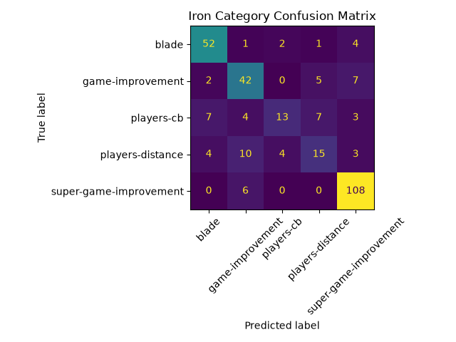

# GolfRec / Stickly

Golf club recommendations from a short playing profile. The app suggests fitting specs, then ranks drivers, fairway woods, iron sets, and wedges from an equipment catalog. Each result includes reasons for the match.

**[Try Stickly](https://www.stickly.fit/)**

The app uses Flask, scikit-learn, pandas, and vanilla JavaScript. This repository contains the recommendation app and training code; the public site also uses a separate [site wrapper](https://github.com/vincent-bui-se/GolfRec-monetize).


## Run locally

The checked-in models use **Python 3.14.4** and the versions in `requirements.lock.txt`. Training environment details are saved in `models/training_environment.json`.

```bash
python -m venv .venv
```

Activate the environment in PowerShell:

```powershell
.\.venv\Scripts\Activate.ps1
```

Or on macOS/Linux:

```bash
source .venv/bin/activate
```

Then install dependencies and start the app:

```bash
python -m pip install -r requirements.lock.txt
python app.py
```

Open [localhost:8502](http://localhost:8502). The model files are included, so training is optional for a first run.

## How recommendations work

1. The form collects handicap or average score, swing speed or carry distance, and preferences for the selected club categories.
2. Five Random Forest classifiers predict driver loft, shaft flex, fairway wood loft, iron category, and wedge bounce. Swing tempo adjusts the displayed flex; ball flight adjusts the wood loft targets.
3. `recommend.py` ranks catalog models using those targets and the golfer's answers. Drivers and fairway woods share a scorer. Irons use their own shot-shape and goal answers. Wedges use turf, divot depth, shot style, and the requested loft.
4. The browser filters the ranked results by MSRP and model year. “Used” means at least four model years old; it does not check inventory or used-market prices.

Selecting a current driver or iron set supplies a baseline launch/spin bucket for trajectory preferences. Without a current-club selection, the scorer uses the stated ball flight and swing speed. Wedges are compared at the closest available loft, considering every bounce/grind configuration at that loft.

## Training and evaluation

The included CSV has **12,000 synthetic golfer profiles**, not measured fitting sessions. `synthetic_data.py` creates profiles and assigns labels using fitting rules, then replaces about 10% of labels with a neighboring category. The generator varies carry distance per mph with handicap rather than using a fixed multiplier, and samples swing speed with a wider spread.

The training task is to approximate those rules from examples. The report also evaluates the rules directly, without the random label replacements, to show whether the forest adds anything on this dataset.

`train.py` reserves a stratified 20% test split for each target and tunes on the remaining 80% with five-fold cross-validation. The forest uses balanced class weights during both CV and the final refit. The search selects hyperparameters by balanced accuracy, giving each class equal weight in the evaluation. The fixed random seed is 42.

The metrics file also reports accuracy across five-fold CV repeated four times on the training rows. Those values describe the selected hyperparameters on reused training data; the held-out split remains the separate evaluation. Models are saved with joblib compression to keep artifact sizes down.

Model and rule-baseline results are evaluated on the same held-out rows. Full results, confusion matrices, and selected hyperparameters are in [`models/metrics.json`](models/metrics.json).

| Target | Model accuracy | Model balanced accuracy (CV) | Rule accuracy |
| --- | ---: | ---: | ---: |
| Driver loft | 0.907 | 0.870 | 0.913 |
| Shaft flex | 0.898 | 0.858 | 0.900 |
| Fairway wood loft | 0.892 | 0.897 | 0.896 |
| Iron category | 0.828 | 0.809 | 0.901 |
| Wedge bounce | 0.902 | 0.901 | 0.902 |

These measurements describe agreement with the synthetic labels. They do not measure whether a club will improve a real golfer's results. The baseline already knows the label-generation rules, so its advantage over the forest is expected.



To retrain from the included CSV:

```bash
python train.py
```

To regenerate the 12,000 profiles with seed 42 before training:

```bash
python synthetic_data.py
python train.py
```

Scikit-learn is pinned to 1.8.0 because 1.9.0 fails when balancing integer-like string labels such as lofts. See the [upstream issue](https://github.com/scikit-learn/scikit-learn/issues/34883). Changing library versions requires retraining and checking the saved artifacts.

## Tests

Run the Python tests:

```bash
python -m pytest tests -q
```

With Node.js 24 installed, test the same filtering functions that the page imports:

```bash
node --test tests/filters.test.mjs
```

The tests cover request validation, feature encoding, model training, recommendation behavior, and browser-side budget, condition, and tie filtering. The GitHub Actions workflow is configured to run both suites on Windows and Linux.

## Data and limits

The equipment files adapt the [Golf Equipment Database](https://github.com/golferx/golf-equipment-database) by GolferX, Inc., licensed [CC BY-SA 4.0](https://creativecommons.org/licenses/by-sa/4.0/). The app uses 70 driver, 37 fairway wood, 59 iron-set, and 29 wedge records. Additional catalog categories are included but are not recommendation targets.

Catalog fields have different levels of evidence. Some forgiveness ratings are measured, others are estimates, and some records have no confidence tag. MSRP is a catalog value rather than a current retailer quote. Equipment metadata retains the source attribution.

The fitting rules draw on these references:

- [MyGolfSpy shaft flex chart](https://mygolfspy.com/news-opinion/instruction/golf-driver-shaft-flex-chart-find-the-right-flex-for-your-swing-speed/)
- [LAZRUS Golf driver loft guide](https://lazrusgolf.com/blogs/news/golf-driver-loft-chart)
- [TaylorMade game-improvement irons guidance](https://www.taylormadegolf.com/clubhouse/1286718-who-should-play-game-improvement-irons.html?lang=en_US)
- [PGA TOUR Superstore club fitting guide](https://www.pgatoursuperstore.com/learning-center/golf-club-fitting-guide.html)

The app does not measure launch angle, spin, impact location, or other launch-monitor data. When given only swing speed or carry, it estimates the other using 2.35 yards per mph; that approximation does not capture the handicap-dependent carry distribution used in training. It ranks individual wedge models rather than building a gapped wedge set. Real fitting outcomes and expert-labeled examples would be needed to evaluate it beyond the synthetic rules.

## Code map

| File | Responsibility |
| --- | --- |
| `app.py` | Flask routes, input validation, model inference, response data |
| `preprocess.py` | Catalog loading, feature encoding, shared input choices |
| `synthetic_data.py` | Profile generation, fitting rules, direct-rule baseline |
| `train.py` | Hyperparameter search, evaluation, model artifacts |
| `recommend.py` | Catalog scoring, explanations, ranking, model-year merging |
| `static/app.js` | Form behavior, result rendering, keyboard interactions |
| `static/filters.mjs` | Budget, condition, and result-display filtering |
| `templates/index.html` | Questionnaire and results markup |
